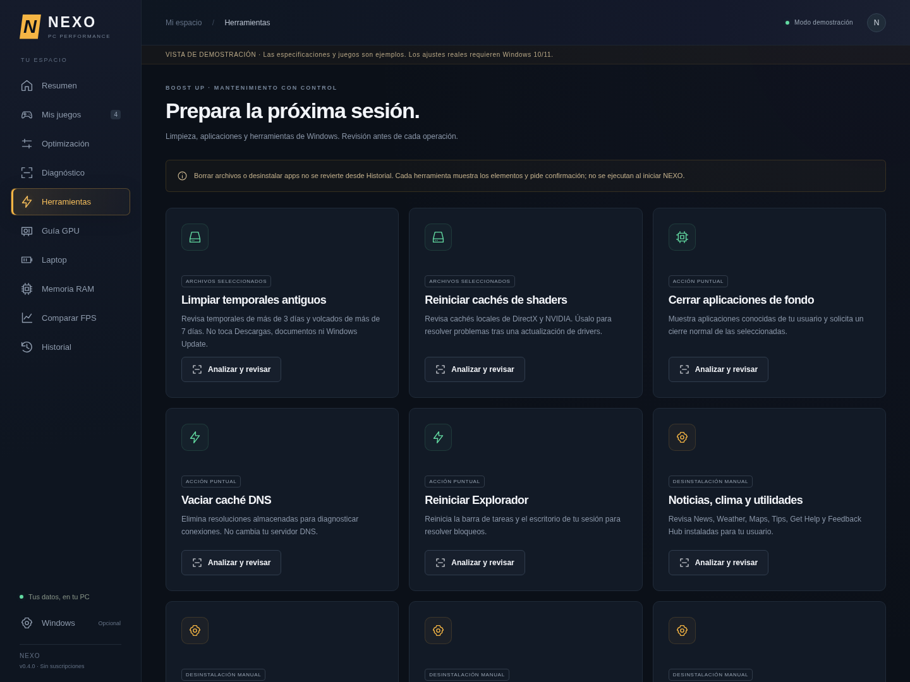

# NEXO · PC Performance 0.4.0

Aplicación portable en español para **Windows 10/11 x64**. Detecta el equipo, permite revisar cambios de Windows y perfiles por juego, y compara capturas reales de FPS. El catálogo se adapta al sistema y a los componentes que Windows exponga; no todos los ajustes estarán disponibles en todos los equipos.


## Abrir o actualizar

1. Cierra la versión anterior y extrae **todo** `NEXO-Windows-x64.zip` en una carpeta nueva.
2. Abre `NEXO-win32-x64/NEXO.exe`. Conserva todos los archivos juntos.
3. Para los controles marcados **ADMIN**, cierra NEXO y usa **Ejecutar como administrador**. La app no se eleva por su cuenta. El escaneo, las preferencias de usuario y los perfiles normales no requieren esa elevación.
4. En **Optimización**, selecciona ajustes, abre **Revisar cambios** y comprueba los efectos antes de aplicar. Seleccionar un preset solo prepara una selección.
5. En **Historial**, restaura ajustes individuales o todos los cambios activos. **Cerrar NEXO no restaura los cambios.**

El formato de datos sigue siendo versión 1: conserva biblioteca, perfiles, capturas e historial de 0.1–0.3 en `%APPDATA%/nexo-pc/state.json`. No borres esa carpeta con cambios pendientes ni ejecutes dos versiones a la vez. La distribución sigue sin firma digital. No hace falta desactivar protecciones de Windows o del juego para usar NEXO.

## Nuevo en 0.4.0

Se revisó estáticamente el ZIP **FrameForge-v1.0.zip** proporcionado por el usuario, sin ejecutar sus scripts. Se implementaron sus funciones con código de NEXO y controles propios. El inventario de sus **81 ajustes** y su correspondencia está en [docs/frameforge-coverage.json](docs/frameforge-coverage.json), con SHA256 del archivo de referencia. Algunos controles se dividen entre varios interruptores existentes; las cuatro colecciones de desinstalación se gestionan en Herramientas.

- **102 ajustes en 11 categorías:** Gaming, GPU, CPU, Background, Storage, Network, Debloat, Desktop, Input, Privacy y Advanced.
- **GPU:** HAGS cuando la instalación ya expone su preferencia, prueba de MPO, política de drivers, MSI para dispositivos PCI NVIDIA con preferencia existente y telemetría NVIDIA heredada. No se afirma que una GT 1030 u otra GPU concreta soporte automáticamente todas las funciones.
- **CPU y energía:** MMCSS, respuesta multimedia, refuerzo de primer plano, parámetros AC del plan, USB, PCIe, discos, hibernación y plan dedicado de rendimiento. Ninguno hace overclock. El plan dedicado solo duplica un plan de rendimiento que Windows ya ofrezca; no fuerza planes en Modern Standby.
- **Memoria y almacenamiento:** compresión de memoria, SysMain, búsqueda e indicadores NTFS, siempre opcionales y con sus costes explicados. Tener 32 GB o SSD no es motivo suficiente para desactivarlos.
- **Red:** prueba TCP sin Nagle, límite multimedia, intercambio P2P de actualizaciones, ahorro del adaptador y DNS IPv4 Cloudflare. Se conserva DHCP/DNS estático y no se cambia IPv6. Estos ajustes no prometen reducir el ping.
- **Privacidad y funciones:** políticas y preferencias de Copilot, Widgets/noticias según Windows, Recall desde 24H2, actividad, diagnóstico, escritura, ubicación, OneDrive y servicios concretos. Los cambios que afectan funciones lo explican antes de aplicar.
- **Advanced, oculta por defecto:** opciones de arranque, kernel, agrupación de servicios y mitigaciones de seguridad. Se habilita en **Windows → Mostrar categoría Advanced**. Los cambios de seguridad exigen casilla y la frase `ACEPTO EL RIESGO`; nunca pertenecen a un preset. Reducir VBS o mitigaciones puede debilitar la seguridad e incumplir requisitos de un juego. No se modifican UEFI, Secure Boot ni anti-cheat. BCD queda bloqueado con BitLocker protegido o sin lectura fiable, sin suspender el cifrado.
- **9 herramientas revisables:** temporales antiguos, cachés de shaders, cierre normal de apps, caché DNS, reinicio del Explorador y cuatro colecciones de apps de Store. Cada operación muestra elementos y pide confirmación; no se ejecutan al iniciar.
- **Diagnóstico:** CPU, RAM por módulo y velocidad reportada, placa/BIOS, driver y pantalla, discos físicos/volúmenes, inicio e integridad de memoria. Un número de módulos no se presenta como prueba de dual channel. Un driver antiguo no se compara con una base de versiones ni se actualiza automáticamente.
- **Guía GPU:** ajustes manuales de latencia, resolución, reescalado, VRAM y sincronización; accesos a herramientas de Windows, panel NVIDIA y páginas oficiales de drivers. No se escriben perfiles internos del controlador ni archivos del juego.
- **Restore Center:** originales persistentes, restauración en orden inverso, intento de punto de restauración antes del primer lote del equipo por sesión, creación manual, exportación de copia JSON y registro local de operaciones. Si Windows no crea un punto (permisos, protección deshabilitada o frecuencia), se registra el motivo sin afirmar que existe ni cambiar esos límites.



## Cambios restaurables y operaciones permanentes

Antes de cada ajuste se guarda el estado original y se comprueba otra vez el destino. El registro conserva tipo, valor y ausencia originales; las claves nuevas solo se eliminan si su hoja queda vacía. Servicios conservan modo de inicio, inicio diferido y estado; tareas conservan habilitación; adaptadores se identifican por GUID. Los parámetros de energía cambian **solo AC**, también al restaurar: se mantienen las decisiones de batería hechas fuera de NEXO. Si desaparece un dispositivo o no se puede restaurar, se muestra el error y se conserva la copia.

Las revisiones caducan a los cinco minutos y solo se usan una vez. Cambios incompatibles o solapados no se pueden apilar. Un lote fallido intenta restaurar los pasos ya intentados; un rechazo confirmado antes de escribir no revierte cambios ajenos. Una copia de plan NEXO no se elimina mientras sus parámetros tengan restauraciones pendientes. Si cambias Windows manualmente después, restaurar solicita el original registrado, no el último valor externo.

**Configurado** significa que la preferencia guardada coincide, no que se haya comprobado su efecto final en un driver, política, servicio tras reinicio o juego. Windows puede ignorarla, impedirla o cambiarla durante actualizaciones. Reinicios y cierres de sesión son manuales.

**Eliminar archivos o apps es permanente y no se revierte desde Historial.** Los paquetes se eligen individualmente y se eliminan solo para el usuario actual; no se eliminan frameworks, Store, instalador, Gaming Services ni juegos Xbox. Puede perderse información local. Reinstalación manual desde Store si la app sigue disponible. Un punto de restauración no es una copia de documentos ni una garantía de recuperar datos de apps.

La limpieza solo analiza temporales de más de tres días y CrashDumps de más de siete, o las cachés de shaders indicadas. No borra Descargas, documentos, Prefetch ni descargas de Windows Update. Hay un límite de 5000 archivos por análisis. Omite archivos nuevos, cambiados, en uso o redirigidos. Rechaza junctions/enlaces y verifica ruta final, tamaño y fecha mediante un handle Win32 antes de eliminar por ese mismo handle. Las apps de fondo reciben `CloseMainWindow`, sin cierre forzado: atiende los diálogos de guardado. Reiniciar Explorer es una operación separada con aviso sobre copias en curso.

La exportación JSON es una **copia de consulta** del estado local, no una importación automática de comandos ni sustituto de Restaurar sistema. Incluye inventario, perfiles, historial y hasta 1000 eventos. Puedes abrir la carpeta de datos desde Historial.

## Funciones que se conservan

- **Hub y logos locales:** CS2, VALORANT, Fortnite, League of Legends, Dota 2, Roblox y PUBG; el resto tiene tarjeta genérica. Solo aparecen instalaciones detectadas/añadidas. Logos Simple Icons (CC0), marcas de sus titulares; fuentes y hashes en `docs/game-art-sources.json` y licencia en `docs/SIMPLE-ICONS-LICENSE.md`. Animaciones respetan reducir movimiento. No se descargan imágenes al ejecutar.
- **Solo Windows 10/11 cliente:** nombre, tipo de producto y build se comprueban en backend y nativo. Server y otros sistemas quedan en consulta; la restauración de un historial previo sigue permitida. La compatibilidad considera build, componentes, preferencias existentes y permisos, además del número de versión. Las políticas escritas por NEXO se identifican como tales; no se eluden políticas de una organización y pueden ser sobrescritas por ellas.
- **Laptop separada:** identificación por chasis/tipo, batería y cargador en vivo. No confunde una UPS con portátil. Los planes y todos los ajustes de energía de laptops aparecen solo en **Laptop**, sin interruptor energético en el perfil del juego. Requieren AC confirmado y vuelven a comprobarlo antes de escribir. No cambia límites térmicos, ventiladores, suspensión ni tapa.
- **Biblioteca local:** manifiestos Steam (incluidas bibliotecas en discos externos), Epic y entradas Riot. No explora todo el disco. Xbox/otros launchers se añaden por `.exe`. Algunas instalaciones Riot no registran carpeta y requieren selección manual.
- **Perfiles por juego:** plan Alto rendimiento existente en escritorio, prioridad opcional `AboveNormal` en procesos de tu usuario, preferencia GPU por ejecutable y prueba de pantalla completa clásica. El `.exe` debe estar dentro de la instalación. Se preservan otros parámetros gráficos y flags de compatibilidad. Steam usa su URI oficial; inicia otros juegos con su launcher si requieren autenticación. No se aplican prioridades High/Realtime ni se evita una denegación del juego.
- **RAM en vivo y selectiva:** CPU/RAM cada segundo con un proceso de monitorización persistente. GB disponibles, porcentaje, hora y 60 muestras sin reconstruir controles. `EmptyWorkingSet` solo sobre navegadores, Discord, Teams o Spotify elegidos de tu usuario, excluyendo primer plano y juegos. No hay liberación automática. Las páginas pueden volver a RAM y su lectura posterior puede causar tirones.
- **GPU en vivo opcional:** NVIDIA GPU 0 mediante `nvidia-smi`, cada tres ciclos con tiempo de espera limitado; uso, temperatura y VRAM cuando el driver los devuelve. Sin herramienta compatible o con lectura antigua se muestra sin datos. No se inventan métricas de AMD/Intel, temperatura de CPU ni VRAM a partir del nombre.
- **Apariencia opcional:** Desktop y Windows conservan interruptores separados para animaciones/transparencia/menús. Los presets gaming no incluyen cambios visuales.

## Comparar FPS

Ningún optimizador garantiza más FPS en cualquier juego. Una limitación de GPU, temperatura o motor puede no mejorar con políticas de Windows; algunos ajustes empeoran rendimiento, autonomía o estabilidad. No se muestran ganancias estimadas ni una puntuación artificial de optimización.

1. Captura un único proceso con PresentMon o exporta CSV de frametimes desde CapFrameX (herramientas externas opcionales, no incluidas).
2. Usa la misma resolución, ajustes, duración, escena y recorrido; espera a que termine la compilación de shaders.
3. Importa Antes y Después con juego y condiciones iguales. Repite varias veces; una diferencia no demuestra causalidad.

Columnas en ms: `MsBetweenPresents`, `FrameTime`, `FrameTime (ms)` o `MsBetweenAppStart`. Mínimo 120 muestras positivas finitas, máximo 20 MB. Se rechazan varios ProcessID y timelines incompatibles. Se conservan tirones largos. FPS medios = frames / tiempo total; 1 % low = 1000 / media del 1 % más lento de frametimes, redondeando cantidad hacia arriba. P99 usa rango más cercano. Los datos miden cadencia de frames según la columna, no latencia de entrada ni necesariamente frames mostrados. No hay overlay, inyección ni lectura de memoria del juego.

## Desarrollo y verificación

Node **24+**, npm y Windows PowerShell **5.1** para nativo. Políticas corporativas pueden bloquear PowerShell: no se cambia la política de ejecución.

```sh
npm ci
npm run check
npm test
npm start

# Demo explícita en navegador, sin cambios reales
npm run preview

npx playwright install chromium
npm run test:ui
# Si Chromium ya está instalado:
# PLAYWRIGHT_CHROMIUM_EXECUTABLE_PATH=/usr/bin/chromium npm run test:ui

# Solo en Windows
npm run test:native

# Carpeta portable, también desde Linux
npm run package:win
```

En Linux/macOS, Electron muestra demostración identificada con hardware y métricas ilustrativos. El servidor preview solo escucha en loopback y no ofrece acciones nativas. En entornos con proxy se conservan TLS, CA y verificaciones SHA256; Node 24 reciente admite `NODE_USE_ENV_PROXY=1` y `NODE_USE_SYSTEM_CA=1`.

El workflow Windows valida lógica/UI, políticas con fakes explícitos, lecturas nativas, registro y preferencias por juego, prioridad, CPU/RAM y recursos del sistema. Las escrituras de sistema de prueba se limitan a **claves/servicios/tareas desechables y un plan clonado temporal**. La limpieza se comprueba solo con archivos creados por la prueba, incluyendo un enlace junction que debe preservarse. No se modifican BCD, mitigaciones, GPU, adaptadores reales ni apps del runner para probarlos.

GitHub usa **Windows Server**: se verifica su rechazo real y se prueban ramas Win10/11 con fixtures exclusivos de tests, ejecutando las API Win32 en el kernel Windows real. Los fixtures y tests no se empaquetan ni existen como un modo de usuario. Esto **no sustituye la validación en un Windows 10/11 físico, un portátil real o tus juegos**. No se ha medido una mejora de FPS en tu equipo. Las preferencias dependientes de hardware/driver y el éxito real de un punto de restauración necesitan esas condiciones locales.

Tras pasar las comprobaciones, `main` publica una prerelease `preview-<SHA>` con `NEXO-Windows-x64.zip`. PR solo valida/empaqueta. El ZIP no es una certificación de rendimiento.

Arquitectura: Electron con sandbox, aislamiento de contexto, CSP local, sin Node en renderer e IPC limitado a operaciones conocidas. Los catálogos y scripts son del paquete; la interfaz solo transmite IDs/selecciones. No se ejecuta texto ni scripts del ZIP de referencia. Inventario, perfiles y resultados permanecen locales; no se envían estadísticas a servidores. No se modifican Defender, BIOS/UEFI ni sistemas anti-cheat, ni se realizan actualizaciones de drivers u overclock.
