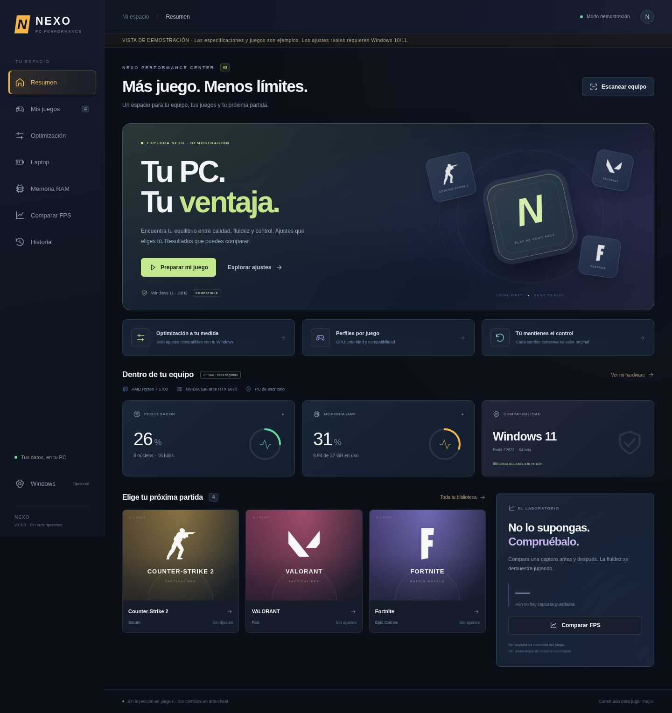

# NEXO · PC Performance

Aplicación de escritorio en español para Windows 10/11 x64. Creada desde cero para revisar el equipo, preparar sesiones de juego y medir resultados, con una interfaz oscura inspirada en las referencias del proyecto.



## Abrir en Windows

1. Descomprime **NEXO-Windows-x64.zip** completo.
2. Abre `NEXO.exe` dentro de `NEXO-win32-x64`. Conserva juntos todos los archivos de esa carpeta.
3. El hardware y los juegos compatibles se escanean al iniciar. «Buscar juegos» actualiza la biblioteca; «Añadir juego» permite seleccionar otros `.exe`.
4. Abre el perfil de un juego. Guarda los ajustes o pulsa **Guardar y aplicar**. Si activas prioridad, inicia primero el juego desde su launcher oficial.
5. Al terminar, abre **Historial → Restaurar** para recuperar tu configuración original. Cerrar NEXO **no** restaura el plan de energía.

La distribución es portable y **no tiene firma digital**. Windows puede mostrar una advertencia de reputación. La aplicación no necesita ejecutarse como administrador para el flujo normal; respeta las denegaciones de acceso. No desactives protecciones del sistema ni del juego para usarla. PresentMon/CapFrameX son herramientas externas opcionales, no se incluyen ni se descargan automáticamente.

## Qué hace de verdad

- **Hardware automático:** CPU, núcleos/hilos, modelo y versión de controlador de GPU, RAM física disponible, Windows y capacidad libre de volúmenes accesibles, incluidos discos externos conectados. CPU y RAM se muestrean cada segundo mediante un único proceso de monitorización persistente. Se actualizan los números, la hora y el gráfico sin reconstruir los controles; si la señal se interrumpe, se indica y se intenta reconectar. El uso de GPU aparece como no disponible; no se inventan métricas ni VRAM.
- **Juegos instalados:** manifiestos locales de Steam, bibliotecas de Steam en otras unidades, manifiestos de Epic y entradas de desinstalación de Riot. No explora recursivamente tus discos. Xbox y otros launchers requieren añadir el ejecutable. Algunas instalaciones de Riot no registran `InstallLocation`: añádelas manualmente.
- **Perfiles individuales:** plan Alto rendimiento existente y prioridad opcional `AboveNormal` para procesos del juego de tu usuario. Los ejecutables manuales se identifican por su ruta exacta. Los juegos Steam se inician con su URI oficial; Epic y Riot se abren desde sus launchers, sin inventar argumentos de autenticación.
- **Consejos por juego:** CS2, VALORANT, Fortnite y Apex tienen recomendaciones de sus propios menús. Para otros juegos se muestran pautas generales. Son sugerencias manuales: NEXO no edita configuraciones ni garantiza que una opción exista en todas las versiones.
- **RAM selectiva:** lista procesos elegibles de Chrome, Edge, Firefox, Discord, Teams y Spotify de tu usuario y sesión. Solicita `EmptyWorkingSet` solo para los PIDs que selecciones y vuelve a comprobar elegibilidad. Excluye el proceso en primer plano. No mata procesos ni vacía cachés globales, ni comprime o purga memoria de juegos. Puede afectar a pestañas de un navegador que tenga otros procesos abiertos: úsalo solo con aplicaciones que no estés utilizando.
- **Windows visual separado:** cambio opcional de `SPI_SETCLIENTAREAANIMATION`; jamás se aplica con el perfil del juego. Se consulta y registra el valor anterior.
- **Historial persistente:** guarda el valor original antes de llamar a Windows. Las operaciones ambiguas permanecen recuperables. Si una aplicación falla parcialmente, intenta restaurar los pasos anteriores; conserva cualquier error. Las prioridades incluyen PID y hora de inicio: un PID reutilizado no recibe una restauración de otro proceso.
- **Comparación real de capturas:** importa CSV de frametimes y calcula FPS medios, 1 % low y P99 de tiempos de fotograma. No hay overlay, inyección, lectura de memoria del juego ni captura integrada.

## Nuevo en 0.3.0

- **Nuevo hub:** navegación renovada, tarjetas de acceso, diagnóstico de Windows, laboratorio de capturas y animaciones que se desactivan al solicitar reducir movimiento.
- **Logos locales:** Counter-Strike 2, VALORANT, Fortnite, League of Legends, Dota 2, Roblox y PUBG. Solo se ilustran juegos detectados o añadidos; no se inventan instalaciones. Los juegos no reconocidos muestran una tarjeta genérica. Logos de Simple Icons (CC0); marcas de sus respectivos titulares. Fuentes y SHA256 en `docs/game-art-sources.json`; licencia incluida en `docs/SIMPLE-ICONS-LICENSE.md`. No se descargan imágenes al ejecutar NEXO.
- **Solo Windows 10 y 11 de escritorio:** se leen nombre, edición, compilación, arquitectura y tipo de producto. Windows Server, Windows 8 y otras versiones quedan en consulta, con cambios bloqueados en el backend y en las operaciones nativas. Restaurar valores de un historial existente sigue permitido. Linux/macOS mantienen únicamente la demostración explícita.
- **Biblioteca compatible por defecto:** la versión detectada determina qué preferencias se muestran. «Ver todo el catálogo» permite consultar el resto con controles bloqueados. No se decide la compatibilidad solo por el número de compilación de Server. El catálogo tiene 35 preferencias, ocho de Gaming; varias dependen también de la existencia del valor o de políticas de Windows.
- **Gaming por ejecutable:** preferencia de GPU de alto rendimiento y prueba opcional de compatibilidad de pantalla completa clásica. Asigna el `.exe` real desde el perfil, dentro de su instalación. Las preferencias se guardan en Windows, conservan otros parámetros existentes y se restauran desde Historial. No cambian gráficos del juego ni hacen overclock. La prioridad y los consejos por juego se mantienen.
- **Windows 11 22H2+:** preferencia de optimizaciones para juegos DX10/11 en ventana/sin bordes, combinada con la cadena existente sin borrar otros parámetros. La grabación del cursor en clips también puede desactivarse si la instalación expone ese valor. Son preferencias, no una garantía de FPS; pueden ser ignoradas o resultar contraproducentes en algunos juegos.
- **Laptop en su propia pestaña:** se identifica por chasis/tipo de equipo, sin confundir una UPS con un portátil. Muestra batería y cargador, y revisa planes existentes Alto rendimiento, Equilibrado o Ahorro. Alto rendimiento exige alimentación AC confirmada, tanto al revisar como al aplicar. No se crean planes para evitar las restricciones de Modern Standby. En laptops, el control de energía desaparece del perfil de juego y se gestiona aquí. Ahorro puede bajar FPS; Alto rendimiento puede aumentar temperatura/ruido. Cerrar NEXO no restaura el plan.

Los perfiles, capturas y el historial de 0.1/0.2 se conservan en la misma carpeta de usuario. Cierra la versión anterior antes de abrir 0.3. La compatibilidad con una preferencia significa que está disponible para revisar y guardar; no demuestra su efecto en cada combinación de Windows, driver y juego.

El workflow usa un runner **Windows Server** de GitHub, detecta que no es un SO de usuario admitido y comprueba el bloqueo real. Para ejercitar las ramas Windows 10/11 usa fixtures explícitos exclusivos de pruebas; las llamadas Win32, escrituras de registro, restauración, procesos y muestras se ejecutan en el kernel Windows real del runner. Los fixtures no se empaquetan ni existen como un modo o variable de la aplicación. Esto no sustituye probar la interfaz completa en un Windows 10/11 físico ni medir FPS en tus juegos.

## Nuevo en 0.2.0: biblioteca de ajustes

En 0.2 se añadieron **33 preferencias** en seis categorías: Gaming (6), Background (4), Debloat (6), Desktop (5), Input (4) y Privacy (8). Incluyen Modo Juego, desactivar captura de Xbox y grabación histórica, audio/micrófono de clips, botón del mando para Game Bar, aplicaciones reiniciables, consejos de Windows, sugerencias del Explorador, Widgets, animaciones/transparencia, aceleración del puntero, atajos de accesibilidad, identificador publicitario y portapapeles.

**Seleccionar no aplica.** Filtra o busca, selecciona y pulsa **Revisar cambios**. La revisión enumera los efectos; **Aplicar estos ajustes** vuelve a leer Windows antes de escribir. Si el valor cambió durante la revisión, el lote se cancela para no conservar una copia obsoleta. La revisión dura cinco minutos y solo sirve una vez. Si una escritura falla, intenta restaurar todos los ajustes intentados; las restauraciones fallidas permanecen recuperables en Historial.

Los cambios son de tu usuario (HKCU), con valores originales y tipos registrados, incluida su ausencia. Se elimina únicamente un valor creado o una clave hoja vacía que no existía; nunca se borra un árbol de claves ni otros valores. No se escriben políticas del equipo. Los controles que detectan una política relacionada aparecen como administrados. Los ajustes exclusivos de Windows 10 se bloquean en Windows 11; algunos requieren que el valor ya exista para evitar crear preferencias que esa instalación no reconoce.

**Configurado** significa que los valores guardados coinciden con la preferencia solicitada, no que se haya medido un aumento de FPS. Ciertas preferencias pueden ser ignoradas por una versión o política de Windows. La interfaz indica cuándo cerrar sesión; no cierra sesión ni reinicia el Explorador automáticamente. Desktop cambia el aspecto y siempre es opcional. Debloat oculta sugerencias y botones, no desinstala apps. Input conserva las opciones de accesibilidad existentes y solo retira sus atajos. Desactivar captura no desinstala Game Bar.

La RAM muestra GB disponibles con dos decimales, uso, hora de la última muestra y un gráfico de 60 muestras. El monitor usa `GlobalMemoryStatusEx` y `GetSystemTimes`; no ejecuta consultas CIM ni vuelve a compilar PowerShell en cada lectura. Al cerrar NEXO se termina el proceso de monitorización. La demostración genera muestras variables claramente identificadas; no son mediciones del PC anfitrión.

Para actualizar desde 0.1.0 o 0.2.0, cierra NEXO y extrae la nueva carpeta en otra ubicación. Conserva `%APPDATA%/nexo-pc/state.json`: es compatible y mantiene el historial anterior y tus perfiles. No ejecutes dos versiones a la vez.

## Qué esperar del rendimiento

No existe un ajuste que aumente FPS en cualquier juego. Si limita la GPU, cambiar el plan de energía o prioridad puede no ayudar; en portátiles puede aumentar temperatura y reducir rendimiento sostenido. El programa no crea el plan Alto rendimiento en equipos Modern Standby que no lo tengan y rechaza activarlo sin corriente AC confirmada.

Para el Ryzen 7 5700, RTX 5070 y 32 GB de RAM, lo útil es identificar el límite real del juego, revisar temperatura/consumo fuera de NEXO y probar opciones del juego como DLSS, trazado de rayos, sombras o límites de FPS. NEXO detecta las especificaciones reales de cada equipo: no supone que tu laptop tenga el mismo hardware.

Windows usa RAM como caché de forma deliberada. Reducir conjuntos residentes no crea RAM nueva ni demuestra una mejora; las aplicaciones recuperan páginas cuando las necesitan y eso puede provocar tirones. No hay liberación automática ni promesas de «RAM optimizada».

No se modifican Defender, Windows Update, servicios, red, BIOS, temporizadores, parámetros de arranque, afinidad, drivers o sistemas anti-cheat. Ninguna aplicación puede garantizar compatibilidad con todas las políticas de todos los juegos; si un proceso rechaza un cambio, NEXO muestra el error y no intenta eludirlo.

## Comparar FPS

1. Captura **un único proceso** con PresentMon, o exporta CSV de frametimes desde CapFrameX. No sirve su JSON ni un CSV de resumen de FPS.
2. Usa resolución, ajustes, recorrido, duración y condiciones iguales; espera a que termine la compilación de shaders.
3. Importa «Antes» y «Después» seleccionando el mismo juego y escribiendo exactamente las mismas condiciones.
4. Repite varias veces. La diferencia entre dos capturas no demuestra por sí sola que el ajuste sea la causa.

Columnas aceptadas, en milisegundos: `MsBetweenPresents`, `FrameTime`, `FrameTime (ms)` o `MsBetweenAppStart`. Mínimo 120 muestras positivas finitas, máximo 20 MB. Se rechazan capturas con varios `ProcessID`. Los valores inválidos/cero se omiten; los tirones largos se conservan. FPS medios = fotogramas / tiempo total. 1 % low = 1000 / media del 1 % de frametimes más lentos, redondeando la cantidad hacia arriba. P99 usa el percentil de rango más cercano. No mezcles modos de captura entre comparaciones: estos valores miden cadencia de presentación/inicio de frames según la columna, no latencia de entrada ni necesariamente frames mostrados en pantalla.

## Desarrollo

Necesitas Node.js **24 o posterior** y npm. En Windows se usa Windows PowerShell 5.1 incluido en el sistema; las políticas corporativas de lenguaje restringido o bloqueo de PowerShell pueden impedir las funciones nativas. No se cambia la política de ejecución.

```sh
npm ci
npm run check
npm test
npm start
```

En Linux o macOS, la interfaz utiliza **modo demostración explícito**, con el hardware de ejemplo del usuario. Los juegos y métricas de ese modo son ilustrativos y los cambios están bloqueados. Para revisar la interfaz en un navegador sin entorno gráfico de escritorio:

```sh
npm run preview
```

El servidor de demostración solo escucha en loopback, no proporciona funciones nativas y no es una versión web del optimizador. Usa el checkout existente de la tarea; no necesitas crear un worktree.

```sh
# Pruebas visuales/funcionales de navegador
npx playwright install chromium
npm run test:ui
# Si el entorno ya tiene Chromium:
# PLAYWRIGHT_CHROMIUM_EXECUTABLE_PATH=/usr/bin/chromium npm run test:ui

# Validación EN WINDOWS: consultas, preferencias/restauración, monitor y proceso de prueba
npm run test:native

# Generar carpeta portable para Windows (también desde Linux)
npm run package:win
```

En entornos con proxy, Node 24 reciente admite `NODE_USE_ENV_PROXY=1` y `NODE_USE_SYSTEM_CA=1` para las descargas. Conserva proxy, TLS y verificaciones de integridad. El runtime descargado por `@electron/get` valida SHA256; no se omiten verificaciones.

`npm start` comprueba primero que el runtime esté instalado. Si tu entorno omite scripts de dependencias, puedes prepararlo explícitamente con `node node_modules/electron/install.js`.

La carpeta resultante es `dist/NEXO-win32-x64`. El workflow `.github/workflows/windows.yml` ejecuta validaciones y genera un ZIP descargable como artefacto de Actions. Al finalizar correctamente en `main`, publica también una versión de prueba en Releases, etiquetada `preview-<SHA del commit>`. Las pull requests solo validan y empaquetan; no publican versiones.

## Datos, límites y validación

Se guarda un JSON local en `%APPDATA%/nexo-pc/state.json` (Electron `userData`): biblioteca, perfiles, historial y hasta 100 capturas resumidas. No guardamos el contenido CSV completo ni enviamos telemetría. No borres estos datos si tienes ajustes pendientes de restaurar. Si el JSON está corrupto, el inicio se detiene y conserva el archivo; no sustituye silenciosamente el historial.

No incorpora desinstalación masiva, limpieza de archivos, overclock, control de ventiladores, actualización de drivers, medidor de temperatura ni autoajustes gráficos. Una prioridad restaurada tras terminar el proceso ya no requiere escribir en otro proceso. Los cambios manuales posteriores en Windows pueden hacer que el estado actual difiera del historial: «Restaurar» solicita el valor original registrado.

Las pruebas locales cubren lógica, revisión de lotes, rollback, flujo continuo, interfaz y sintaxis PowerShell. El workflow Windows añade comprobaciones nativas de hardware, lectura del catálogo y la detección de compatibilidad, tres muestras continuas de RAM/CPU, escritura/restauración de preferencias del usuario de prueba y perfiles gráficos por ejecutable y prioridad/restauración de un proceso propio. **Las mejoras de FPS y la detección en instalaciones de juegos reales no se han medido en tu equipo físico.** El ZIP es una primera versión de prueba, no una certificación de rendimiento. Antes de distribuirla públicamente hacen falta esa validación y una firma de código.

Arquitectura: Electron con sandbox, aislamiento de contexto, sin Node en el renderer, CSP local e IPC limitado a operaciones conocidas. El backend valida datos; los comandos PowerShell son del paquete y se pasan como argumentos/base64, sin ejecutar texto del usuario. La interfaz trata nombres de juegos como texto.
